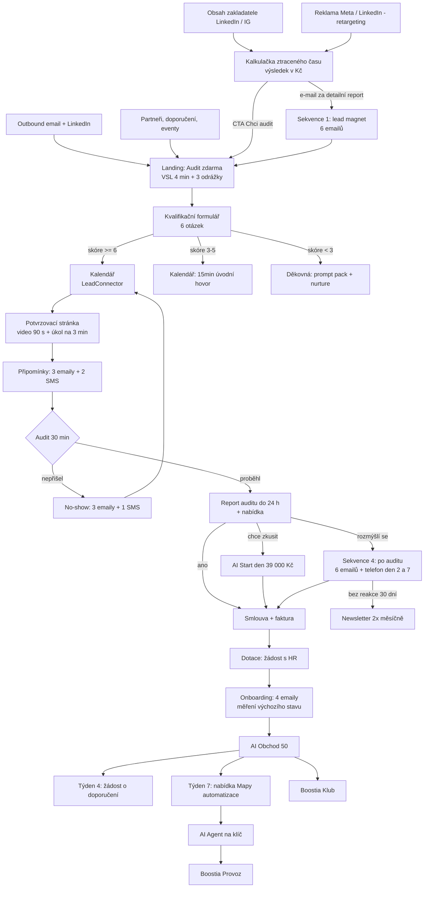

# FÁZE 4 – Funnel

## 4.1 Mapa funnelu

## 4.2 Kvalifikační formulář

Zobrazí se na landing page pod VSL. Krok 1 = jméno, e-mail, telefon, firma (uloží se hned, i když člověk nedokončí). Krok 2 = otázky.

| # | Otázka | Odpovědi (body) |
|---|---|---|
| 1 | Kolik lidí u vás obchoduje (včetně key accountů a obchodní podpory)? | 1–3 (0) · 4–7 (2) · 8–15 (3) · 16–40 (3) · 41+ (2) |
| 2 | Jaká je vaše role? | Jednatel / majitel (3) · Obchodní ředitel / vedoucí obchodu (3) · HR / vzdělávání (2) · Obchodník (0) · Jiná (0) |
| 3 | Jaké CRM používáte? | Raynet / Pipedrive / HubSpot / Salesforce / eWay / jiné (1) · Excel (1) · Žádné (0) |
| 4 | Kdo rozhoduje o investici do vzdělávání obchodu? | Já (2) · Já s někým dalším (2) · Někdo jiný (0) |
| 5 | Kdy byste chtěli začít? | Do 2 měsíců (3) · Do půl roku (2) · Zatím jen zjišťuji (0) |
| 6 | Chcete ověřit nárok na dotaci? | Ano (1) · Ne (0) · Nevím, co to obnáší (1) |
| 7 (nepovinné) | Co vaše obchodníky nejvíc zdržuje od prodeje? | volný text |

**Pravidla směrování:**
- **6 a víc bodů a zároveň aspoň 4 obchodníci** → kalendář na 30min audit se zakladatelem. Tag `audit-kvalifikovany`.
- **3–5 bodů** (typicky HR bez rozhodovací pravomoci, nebo „jen zjišťuji") → 15min úvodní hovor; cílem je přivést na audit ředitele. Tag `audit-uvodni`.
- **Méně než 3 body nebo 1–3 obchodníci** → bez kalendáře. Děkovná stránka s prompt packem, tag `nurture`, sekvence 1. Důvod: program je stavěný pro týmy; malé firmě pošleme odkaz na otevřený AI Start den, až jej vypíšeme **[ROZHODNUTÍ: otevřené termíny zatím neděláme]**.
- **Obchodník bez pravomoci** → prompt pack + email „Přepošlete svému řediteli" s hotovým textem.

## 4.3 Potvrzovací stránka (zvyšuje show-up)

**Headline:** Máte to v kalendáři. Tady je, jak z těch 30 minut dostat maximum.
**Podtitul:** Audit proběhne {{datum}} v {{čas}} přes Google Meet. Odkaz máte v e-mailu i v SMS.

**Video (90 s, vedoucí lektor, natočené na telefon v kanceláři).** Skript:
> „Dobrý den, tady [JMÉNO] z Boostie. Díky za rezervaci. Za 30 minut společně spočítáme, kolik hodin týdně váš obchodní tým tráví prací, kterou dnes zvládne AI, a kolik to dělá v korunách. Nic neprezentuju, ptám se a počítám. Na konci dostanete číslo a tři konkrétní kroky, i kdybychom spolu nikdy nespolupracovali. Aby to číslo sedělo, potřebuju od vás jednu věc: zeptejte se před auditem dvou obchodníků, kolik času jim zabere příprava na schůzku, zápis po ní a jedna nabídka. Stačí odhad. Formulář je hned pod videem, zabere tři minuty. A jestli o vzdělávání rozhoduje ještě někdo další, pozvěte ho rovnou, ušetříte si jedno kolo. Těším se."

**Tři kroky pod videem:**
1. **Přidejte si termín do kalendáře** [tlačítka Google / Outlook / .ics]
2. **Vyplňte 3minutovou přípravu** (4 pole: minuty na přípravu schůzky · minuty na zápis a CRM · hodiny na jednu nabídku · počet schůzek týdně na obchodníka). Uloží se do custom fields, lektor je má před hovorem.
3. **Pozvěte kolegu, který o tom rozhoduje s vámi** [pole e-mail + tlačítko Poslat pozvánku]

**Co čekat (3 řádky):** 5 min: jak dnes váš obchod pracuje · 15 min: počítáme ztracený čas a peníze · 10 min: co s tím, s námi nebo bez nás.
**Co nečekat:** prezentaci o tom, co je umělá inteligence. Tlak na podpis.

**Proč to zvedá show-up:** malý závazek (úkol), konkrétní příslib hodnoty i bez nákupu, tvář a hlas člověka, kalendář jedním klikem.

## 4.4 Scénář 30min auditu

**Příprava (5 min před):** web firmy, LinkedIn účastníka, odpovědi z formuláře a z 3minutové přípravy, otevřená kalkulačka auditu (sdílená obrazovka).

### 0–3 min: Rámec
„Díky za čas. Navrhuju tenhle postup: pár minut se budu ptát, jak u vás obchod funguje. Pak spolu spočítáme, kolik času a peněz jde na práci, kterou zvládne AI. A na konci vám řeknu na rovinu, jestli vám umíme pomoct, nebo ne. Kdyby ano, ukážu jak. Kdyby ne, dostanete aspoň to číslo a tři tipy. Sedí vám to takhle?"

### 3–10 min: Diagnostika
1. „Kolik lidí u vás aktivně obchoduje a co přesně prodávají?"
2. „Jak vypadá typický týden obchodníka? Kolik schůzek nebo hovorů s klienty má?"
3. „Když má zítra schůzku s novou firmou, jak se připravuje a jak dlouho to trvá?"
4. „Co se děje po schůzce? Kdo píše zápis, kdy je v CRM, kdy odchází follow-up?"
5. „Jak dlouho od poptávky trvá, než klient dostane nabídku? Kdo ji skládá?"
6. „Jak pracujete se stávajícími klienty? Kdo hlídá, co by mohli kupovat navíc?"
7. „Kdo v týmu už AI používá a na co? Máte pro to nějaká pravidla?"
8. „Co vás na tom všem štve nejvíc?" *(nechat domluvit, zapsat doslova)*

### 10–20 min: Kvantifikace (sdílená kalkulačka)
„Pojďme to spočítat. Řekněte mi, kdybych někde přestřelil."

| Činnost | Minuty teď | Kolikrát týdně | Realistická úspora s AI | Hodiny týdně |
|---|---|---|---|---|
| Příprava na schůzku | např. 40 | 5 | 60 % | 2,0 |
| Zápis + CRM | 25 | 5 | 70 % | 1,5 |
| Follow-up e-mail | 15 | 5 | 60 % | 0,75 |
| Nabídka | 120 | 1,5 | 40 % | 1,2 |
| Hledání informací, reporty | 90 | 1 | 40 % | 0,6 |

*(Procenta úspory jsou naše pracovní odhady z vlastní praxe, **[PROOF: nahradit průměry z pilotu]**. Na hovoru vždy říct: „Počítám schválně opatrně.")*

„Takže opatrně 6 hodin týdně na jednoho člověka. Já budu počítat s polovinou, 3 hodiny, protože ne všechno se podaří změnit. Máte 10 obchodníků, to je 30 hodin týdně. Kolik vás stojí hodina obchodníka včetně odvodů, auta a režie? *(obvykle 500–800 Kč)* Dobře, 600 Kč. To je 18 000 Kč týdně, 828 000 Kč ročně. A to počítám jen náklad. Kolik obratu udělá obchodník z jedné hodiny navíc u klientů, to víte líp než já."

**Klíčová otázka:** „Co by se u vás změnilo, kdyby měl každý obchodník každý týden tři hodiny navíc na klienty?" *(mlčet)*

### 20–27 min: Most k nabídce
„Můžu vám říct, jak bychom to řešili my?" *(počkat na ano)*
„Máme osmitýdenní program AI Obchod 50. Jeden den v týdnu, u vás, na vašich skutečných zakázkách. První týden změříme stopkami výchozí stav. Pak každý týden jedno téma: bezpečnost, příprava schůzek, zápisy a CRM, nabídky, prospecting a cross-sell, týmoví asistenti. Osmý týden měříme znovu a vedení dostane report v hodinách a korunách.
Cena je 290 000 Kč za tým do 12 lidí. Program má 50 hodin schválně, protože to je minimum pro dotaci z Úřadu práce. Pro deset lidí vychází cena po dotaci zhruba na 160 000 Kč a žádost připravíme s vaším HR.
A garance: první den je na naše riziko. Když po něm řeknete, že to není ono, neplatíte. A když tým při závěrečném měření nezíská aspoň ty 3 hodiny týdně, školíme dál zdarma a pokud to ani pak nevyjde, vracíme čtvrtinu ceny."

### 27–30 min: Další krok (vždy konkrétní)
- **Zájem:** „Nejbližší kohorta startuje [DATUM], volná jsou [X] místa. Aby se stihla dotace, musí žádost odejít do [DATUM]. Pošlu vám dnes report z auditu a návrh smlouvy. Kdy se k tomu můžeme vrátit, ve čtvrtek v 9, nebo v pátek ve 14?"
- **Váhá:** „Rozumím. Nabízím menší krok: AI Start den za 39 000 Kč. Jeden den s celým týmem, změříme výchozí stav a tým si odnese první dvě věci, které hned používá. Když potom půjdete do programu, těch 39 000 odečteme."
- **Není to pro ně:** říct to. „Upřímně, se třemi obchodníky se vám program nevyplatí. Pošlu vám prompt pack a tři kroky, které zvládnete sami."

**Po hovoru do 24 hodin:** jednostránkový report (čísla z kalkulačky, doslovná citace největší bolesti, 3 kroky, nabídka, termíny).

## 4.5 Closing podle CLOSER

| Krok | Co říkáme |
|---|---|
| **C – Clarify** (proč jsou tu) | „Co vás přimělo si audit rezervovat právě teď?" |
| **L – Label** (pojmenovat problém) | „Jestli tomu rozumím: tým je vytížený, ale velká část toho není prodej. Nabídky odcházejí za týden a vy nevíte, kdo co dává do ChatGPT. Je to tak?" |
| **O – Overview** (co už zkusili) | „Co jste s tím už zkoušeli? Jak to dopadlo? Proč myslíte, že to nevydrželo?" |
| **S – Sell the vacation** (cíl, ne cesta) | „Představte si pondělní poradu za tři měsíce: zápisy ze všech schůzek jsou v CRM, nabídky z minulého týdne jsou venku a každý obchodník měl o tři hodiny víc na klienty. K tomu vede osm týdnů, jeden den týdně." |
| **E – Explain away concerns** | viz 4.6 |
| **R – Reinforce** | „Dobré rozhodnutí. Dnes vám přijde smlouva a dotazník pro HR k dotaci. V pondělí volám vašemu HR a domlouvám termín měření. Od vás teď potřebuju jen jména účastníků." |

## 4.6 Deset nejčastějších námitek

| # | Námitka | Odpověď |
|---|---|---|
| 1 | **„290 tisíc je moc."** | „Rozumím, je to hodně peněz. Pojďme se podívat, s čím to srovnáváme. Spočítali jsme, že neprodejní práce vás stojí 828 000 Kč ročně. Po dotaci platíte zhruba 160. A první den můžete odejít zadarmo. Co by muselo platit, aby to pro vás dávalo smysl?" |
| 2 | **„ChatGPT si umí pustit každý, na to nepotřebujeme školení."** | „Souhlasím, pustit si ho umí každý. Kolik vašich obchodníků ho dnes používá každý den na přípravu schůzky a nabídky? *(obvykle 1–2)* Právě. Rozdíl není v nástroji, ale v tom, jestli se z něj stane zvyk celého týmu. To je práce na osm týdnů, ne na jedno odpoledne." |
| 3 | **„Nemůžu lidi pustit na den v týdnu z terénu."** | „To je nejčastější obava. Dvě věci. Zaprvé, v ten den dělají svoji práci: připravují skutečné schůzky a píšou skutečné nabídky, jen jinak. Zadruhé, jde to rozdělit na dva půldny. A od třetího týdne si ten čas vracejí." |
| 4 | **„Školení už jsme měli, vydrželo to týden."** | „To slyším často a máte pravdu, jednodenní školení nevydrží. Proto je program na osm týdnů s úkolem na reálné zakázce každý týden a s měřením na konci. A proto garance: když se výsledek nezměří, školíme dál zdarma." |
| 5 | **„Bojím se o data. Co když někdo nahraje ceník nebo smlouvu?"** | „To se vám nejspíš děje už teď, jen o tom nevíte. Proto je bezpečnost první den, ne poslední. Tým odchází s podepsanou směrnicí, co do AI smí a co ne, a nastavíme firemní účty, kde se data nepoužívají k trénování modelů." |
| 6 | **„Starší obchodníci to nepřijmou."** | „Mají k tomu často nejblíž, protože vědí, co chtějí napsat, jen je nebaví to psát. Každý účastník má individuální 20 minut s lektorem a pracujeme ve dvojicích. A zkušenost z praxe: [PROOF: příběh z pilotu]." |
| 7 | **„Musím to probrat s jednatelem / ředitelem."** | „Jasně. Co bude chtít vědět jako první? *(cena, výsledek)* Pošlu vám report s čísly z dneška na jednu stranu. A nejrychlejší bývá 15 minut ve třech. Hodí se mu čtvrtek ráno?" |
| 8 | **„Dotace jsou papírování a stejně je nedostaneme."** | „Žádost připravíme my s vaším HR, od vás potřebujeme zhruba dvě hodiny. Schválení zaručit neumím, to rozhoduje Úřad práce. Proto vám nejdřív do dvou dnů ověříme nárok a rozhodnete se až potom." |
| 9 | **„Teď ne, máme sezónu / uzávěrku / plánování."** | „Rozumím. Kdy je u vás klidnější období? *(…)* Dobře. Dotace se musí podat před startem a schválení trvá týdny, takže kdybychom chtěli začít v [MĚSÍC], žádost by měla odejít do [DATUM]. Mám vám místo v té kohortě podržet do pátku?" |
| 10 | **„Náš obor je specifický, obecné AI nám nepomůže."** | „Proto nepracujeme s cvičnými příklady. Asistent na nabídky se učí na vašich pěti nejlepších nabídkách, příprava schůzek na vašich klientech. Jaká situace je u vás nejvíc specifická? Zkusme ji teď hned, pět minut." *(živá ukázka)* |

## 4.7 KPI funnelu

| Krok | Metrika | Cíl | Alarm (řešit hned) |
|---|---|---|---|
| Outbound | Doručitelnost | ≥ 97 % | < 94 % |
| Outbound | Míra odpovědí / kladných | ≥ 6 % / ≥ 3 % | < 3 % / < 1 % |
| LinkedIn | Přijetí žádosti / odpověď | ≥ 35 % / ≥ 12 % | < 20 % |
| Kalkulačka | Dokončení / zadání e-mailu | ≥ 55 % / ≥ 25 % | < 35 % / < 12 % |
| Landing Audit | Přehrání VSL / 50 % zhlédnutí | ≥ 40 % / ≥ 35 % | < 25 % |
| Landing Audit | Návštěva → odeslaný formulář | ≥ 8 % studený, ≥ 20 % teplý provoz | < 4 % |
| Formulář | Krok 1 → krok 2 dokončen | ≥ 75 % | < 60 % |
| Kalendář | Kvalifikovaný → rezervace | ≥ 85 % | < 70 % |
| Potvrzovací stránka | Vyplněná příprava | ≥ 50 % | < 30 % |
| Audit | Show-up | ≥ 78 % | < 65 % |
| Audit | Proběhlý → kvalifikovaná příležitost | ≥ 70 % | < 50 % |
| Nabídka | Report odeslán do 24 h | 100 % | < 90 % |
| Prodej | Kvalifikovaná → Start den nebo program | ≥ 30 % | < 15 % |
| Prodej | Start den → program | ≥ 50 % | < 30 % |
| Prodej | Délka cyklu audit → podpis | ≤ 30 dní | > 60 dní |
| Program | Docházka / splněné úkoly | ≥ 85 % / ≥ 80 % | < 75 % |
| Program | Změřená úspora na obchodníka | ≥ 3 h týdně | < 3 h |
| Po programu | NPS / doporučení na klienta / přechod do Klubu | ≥ 50 / ≥ 1 / ≥ 50 % | NPS < 30 |

## Self-review fáze 4

**Kolo 1 – slabiny:** (1) Scénář auditu byl prezentace, ne diagnostika → přepsán na otázky a společné počítání, nabídka až po svolení. (2) Formulář pouštěl do kalendáře každého → bodování a tři větve. (3) Chyběl menší krok pro váhající → AI Start den v závěru hovoru.
**Kolo 2 – slabiny:** (1) Procenta úspor v kalkulačce vypadala jako fakta → označena jako pracovní odhady, lektor říká „počítám opatrně" a dělí výsledek dvěma. (2) Námitka 6 obsahovala vymyšlený příběh → nahrazen placeholderem. (3) KPI bez alarmových hodnot → doplněno.

| Kritérium | Kolo 1 | Finál |
|---|---|---|
| Konkrétnost | 8 | 9,5 |
| Přesvědčivost | 7 | 9 |
| Jasnost | 8 | 9 |
| Konzistence | 9 | 9,5 |
| Proveditelnost | 8 | 9 |
| Pravdivost | 7 | 9 |
